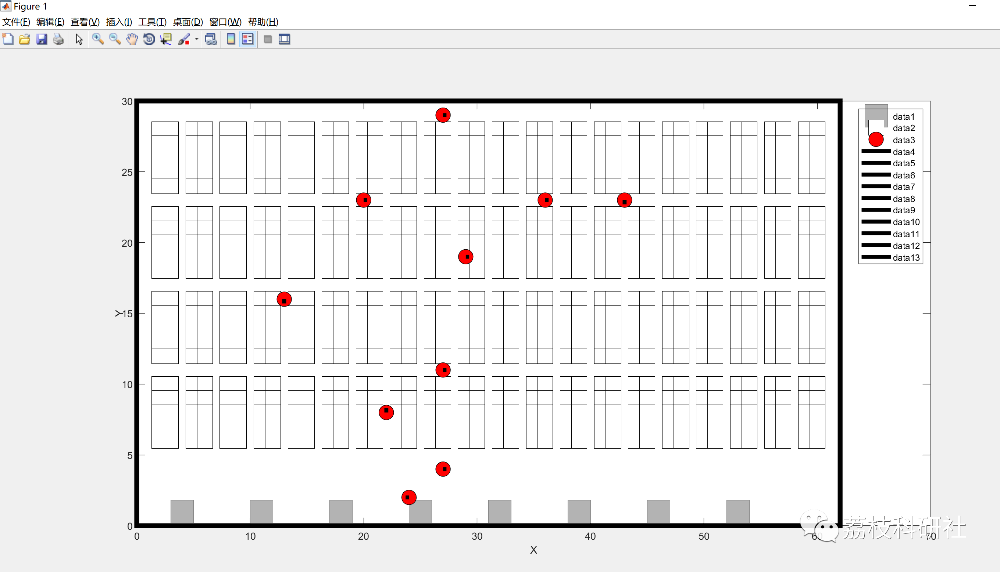
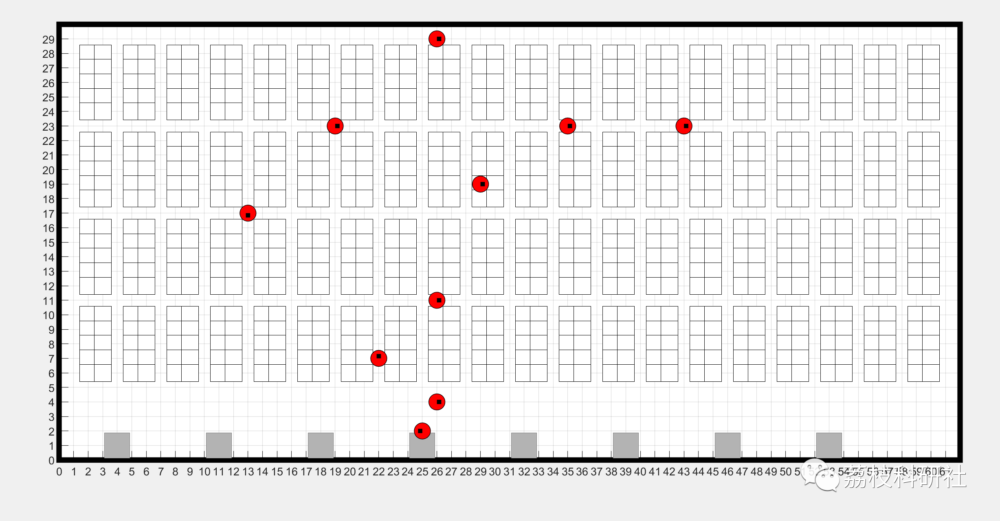

# Path Planning for Mobile Robots Based on a Similar Kiva (Matlab Code Implementation)

💥💥💥💞💞💞 Welcome to this blog❤️❤️❤️ 💥💥💥
🏆 Bloggers' Advantage: 🌞🌞🌞 The content of the blog strives for rigorous thinking and clear logic, making it convenient for readers.
⛳️ Mantra: "The journey of a hundred miles is half done in the ninetieth."
Litchi Research Society
Code Collection: Power Systems, Intelligent Algorithms and Applications, Neural Network Prediction, Path Planning, Optimized Scheduling, Workshop Scheduling, Image Processing, Signal Processing...
🎁 Special Section Links:
🌈🌈🌈🌟🌟🌟🌟 Electrical Code Drone and Physical Applications Path Planning Intelligent Algorithms and Their Applications Optimized Scheduling Neural Network Prediction Workshop Scheduling Image Processing Romantic Her Signal Processing Mathematical Modeling My Thoughts Voice Processing Complete Code Issues
💥1 Overview
Robots are one of today's important research areas, capable of performing many tasks that humans cannot accomplish, including mining, military, rescue, space, etc. In these applications, the navigation of mobile robots mainly depends on their intelligence level, with path planning being the most effective and crucial intelligent function. Path planning aims to find a safe collision-free path from the starting point to the target point based on specific optimization criteria such as path length, walking time, energy consumption.
📚2 Run Results
🎉3 References
[1] Yang Heng, Li Yue, Sun Hanting, Li Zhuo. Path Optimal Mobile Robot Path Planning [J]. Mechanical Design, 2022, 39(08):58-67. DOI:10.13841/j.cnki.jxsj.2022.08.027.
👨‍💻4 MATLAB Code Realization
Click the article below left [Read Full Content]

## Images

<!-- PAYMENT_BLOCK -->

## Get this dataset

- Payment link (Stripe): [Buy now](https://buy.stripe.com/3cs8yP7sY87d0vu9AB)
- Payment QR code: 

<!-- /PAYMENT_BLOCK -->
